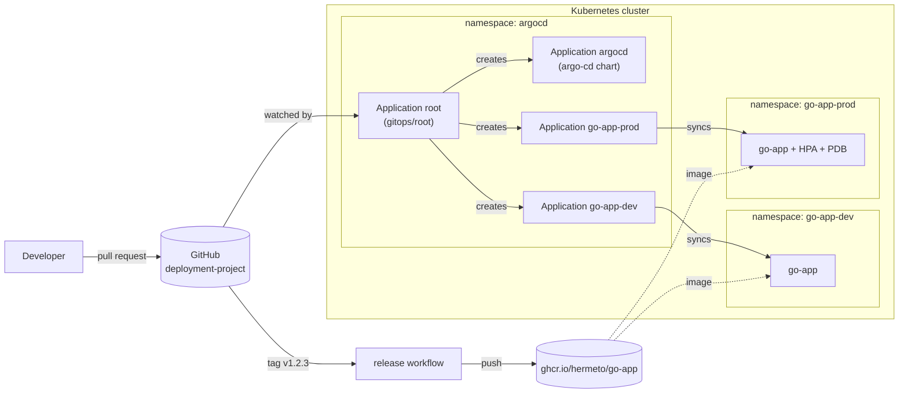

# Go App Deployment Project

[](https://github.com/hermeto/deployment-project/actions/workflows/ci.yml)
[](https://github.com/hermeto/deployment-project/actions/workflows/e2e.yml)

GitOps delivery of a Go service to Kubernetes with [Argo CD](https://argo-cd.readthedocs.io/) and Helm. Git is the
single source of truth: Argo CD installs itself, the application and every environment from this repository, and
keeps the cluster converged on it. The whole pipeline runs on a local [kind](https://kind.sigs.k8s.io/) cluster, so it
can be tested end to end without a cloud account — CI does exactly that on every pull request.

## What you get

| Area | Highlights |
| --- | --- |
| **Application** | Small Go HTTP service (`/`, `/healthz`, `/readyz`) with graceful shutdown: readiness fails first, in-flight requests drain. Static binary on a distroless, non-root image (~4 MB). |
| **Helm chart** | Values validated by a JSON schema (typos and mutable tags such as `latest` fail the render), a single named port used by the Service and every probe, startup/liveness/readiness probes, HPA that owns the replica count, PodDisruptionBudget, NetworkPolicy, topology spreading, optional Ingress. |
| **Security** | `restricted` Pod Security Standard enforced on every application namespace; read-only root filesystem, no capabilities, no service-account token; dedicated AppProjects with an explicit resource allow-list; the `default` project is disabled; `trivy`, `hadolint` and `gitleaks` in CI and pre-commit. |
| **GitOps** | App of apps: one `root` Application manages the AppProjects, Argo CD itself (pinned chart, upgrades through Git) and one Application per environment. Automated sync with self-heal and pruning, retries with backoff. |
| **Environments** | `dev` and `prod` from the same chart with per-environment values; promotion is a pull request that bumps the image tag. |
| **Delivery** | `make check` runs every static test; `make e2e` deploys on kind and proves the GitOps loop works (sync, self-heal, a Git change reaching the cluster); `release` publishes multi-arch images to GHCR; Renovate keeps versions current. |

## Architecture



More detail and the reasoning behind the design (including the monorepo trade-offs) in
[docs/architecture.md](docs/architecture.md); how a change travels from a commit to the cluster in
[docs/gitops.md](docs/gitops.md).

## Repository layout

```text
.
├── app/                    Go service: source, unit tests, Dockerfile
├── charts/go-app/          Helm chart of the service (+ values.schema.json, tests/ for helm-unittest)
├── environments/
│   ├── dev/values.yaml     per-environment values: image tag, replicas, autoscaling...
│   └── prod/values.yaml
├── gitops/
│   ├── argocd/values.yaml  Argo CD configuration (used by the bootstrap and by Argo CD managing itself)
│   └── root/               app of apps: AppProjects + Applications (+ tests/)
├── e2e/git-server.yaml     in-cluster Git server used by the e2e test only
├── kind/cluster.yaml       local cluster definition
├── scripts/                bootstrap, smoke tests, e2e test
├── docs/                   architecture, GitOps workflow, operations, CI
└── Makefile                every workflow: `make help`
```

## Requirements

| Tool | Version | Used for |
| --- | --- | --- |
| [Docker](https://docs.docker.com/get-docker/) | any recent | image build, kind, hadolint, helm-unittest |
| [kind](https://kind.sigs.k8s.io/docs/user/quick-start/#installation) | >= 0.33 | local cluster |
| [kubectl](https://kubernetes.io/docs/tasks/tools/) | any recent | bootstrap and tests |
| [Helm](https://helm.sh/docs/intro/install/) | >= 3.14 (CI uses 4.3) | bootstrap, chart checks |
| [Go](https://go.dev/dl/) | 1.27 | application |
| [golangci-lint](https://golangci-lint.run/), [kubeconform](https://github.com/yannh/kubeconform), [trivy](https://trivy.dev/), [shellcheck](https://www.shellcheck.net/), `jq` | latest | static checks |

`make tools` reports what is missing.

## Quick start: local (kind)

```bash
make e2e         # kind cluster + image + Argo CD + the whole GitOps tree, then the end-to-end tests
make argocd-ui   # admin password, and the UI on https://localhost:8080 (self-signed certificate)
make local-down  # delete the cluster
```

`make e2e` does not need GitHub: it pushes a snapshot of your working tree, uncommitted changes included, to a Git
server inside the cluster and points Argo CD at it. The tests ([`scripts/e2e.sh`](scripts/e2e.sh),
[`scripts/smoke-test.sh`](scripts/smoke-test.sh)) prove that the GitOps loop works, not just that pods run: every
Application is Synced and Healthy, the service answers through its Service from another namespace with the version
Git declares, privileged pods are rejected, a resource deleted by hand is restored by Argo CD, and a commit that
changes the dev replica count is rolled out.

## Deploy to a cluster

Prerequisites, once:

1. Publish the image: push the tag matching the chart `appVersion` (`git tag v1.0.0 && git push origin v1.0.0`).
   The [release workflow](.github/workflows/release.yml) pushes `ghcr.io/hermeto/go-app:1.0.0`. Make the GHCR
   package public, or add `imagePullSecrets` in `environments/*/values.yaml`.
2. Using a fork? Set `repo.url` in [`gitops/root/values.yaml`](gitops/root/values.yaml) to your repository. For a
   private repository, register its credentials in Argo CD first
   ([docs/operations.md](docs/operations.md#private-repository)).

Then, with `kubectl` pointing at the cluster:

```bash
make bootstrap KUBE_CONTEXT=<context>   # installs Argo CD and applies the root Application
make smoke     KUBE_CONTEXT=<context>   # waits for every Application and checks each environment
```

From then on, the cluster follows `main`. Bootstrapping is needed once per cluster; Argo CD upgrades itself when
the chart version in `gitops/root/values.yaml` changes. Access, credentials, rollbacks and troubleshooting:
[docs/operations.md](docs/operations.md).

## Delivering changes

| Change | How |
| --- | --- |
| Application code | Pull request → merge → bump `appVersion` in `charts/go-app/Chart.yaml` → tag `vX.Y.Z` (publishes the image) → bump `image.tag` in `environments/dev/values.yaml`, then in `prod` once validated. |
| Configuration of an environment | Pull request on `environments/<env>/values.yaml`. |
| Chart | Pull request on `charts/go-app` (bump the chart `version`); covered by `helm-unittest` and the e2e test. |
| New environment | Add `environments/<name>/values.yaml` and an entry in `goApp.environments` in `gitops/root/values.yaml`. |
| Argo CD | Pull request on `gitops/argocd/values.yaml` or `argocd.chart.version` (Renovate opens these). |

Nobody runs `kubectl apply` or `helm upgrade` against the cluster after the bootstrap: manual changes are reverted by
self-heal. Details in [docs/gitops.md](docs/gitops.md).

## Testing

| Command | What it proves | Needs |
| --- | --- | --- |
| `make go-fmt go-lint go-test` | gofmt, `go vet`, golangci-lint; unit tests with the race detector (config, handlers, graceful shutdown) | Go, golangci-lint |
| `make docker-lint` | hadolint on the Dockerfile | Docker |
| `make helm-lint` | `helm lint --strict` of both charts, the app chart with every environment's values | Helm |
| `make helm-unittest` | 60 helm-unittest cases: hardening, naming, ports, HPA/replicas, schema rejections, environments, AppProjects, Applications | Docker |
| `make helm-render` | What Argo CD deploys (each environment, root, the pinned Argo CD chart with our values) passes `kubeconform -strict` | Helm, kubeconform |
| `make test-scripts` | shellcheck | shellcheck |
| `make security` | trivy misconfiguration scan of the Dockerfile, charts and manifests | trivy |
| `make image-scan` | trivy vulnerability scan of the image | Docker, trivy |
| `make check` | all of the above except `image-scan` (CI runs it too) | |
| `make e2e` | the full GitOps loop on kind (see above) | kind, Docker, Helm |

## Contributing

See [CONTRIBUTING.md](CONTRIBUTING.md). Security issues: [SECURITY.md](SECURITY.md). Changes: [CHANGELOG.md](CHANGELOG.md).
